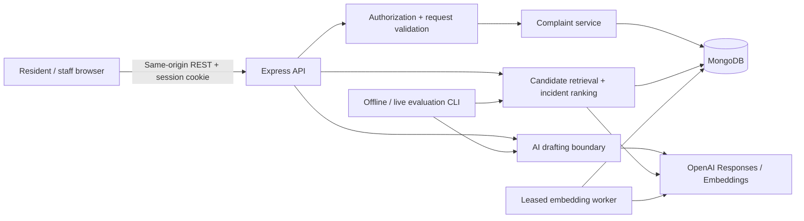

# Civic Desk


A civic complaint intake and review application for **Hyderabad, through an independent demonstration service**. React + TypeScript, Express, MongoDB, and the official OpenAI SDK. It does not send reports to a real municipality. Use synthetic information.

Residents write rough notes, optionally add a photo, review an AI-assisted or manual draft, compare possible duplicates, follow an existing incident or submit a new report, and track staff decisions. Staff confirms content, category, and department; changes status through validated transitions; and links duplicates without merging or deleting records.

New to the codebase? Start with the [beginner developer guide](docs/DEVELOPER_GUIDE.md). For portfolio preparation, see the [local readiness checklist](docs/PORTFOLIO.md).

## Release and verification status

Application implementation is present. **This checkout is not yet an end-to-end verified release.** Local npm connectivity and socket binding now work; backend and real MongoDB checks have run successfully. Browser rendering and interaction have not yet been verified.

Latest recheck (2026-10-19): type checking, production build and **all 47 tests** pass (29 unit tests, 16 real MongoDB HTTP tests and two database-launch port checks). Integration tests passed outside the socket-restricted sandbox. After patch updates to sharp, Vitest and concurrently, `npm audit` reports zero known vulnerabilities. Browser interaction remains unverified. Historical persistence evidence below is from 2026-10-16.

Previously verified in this environment:

- Full TypeScript check and server/client production build.
- 45 tests: 29 unit/provider-contract tests and 16 real MongoDB HTTP integration tests covering authorization, idempotency, status transitions, private uploads, feedback, duplicate links, and stale indexing protection.
- Persistent local MongoDB 7.0.24; repeat seeding preserves all user and complaint documents exactly.
- Running Vite/API HTTP flow: login, AI-unavailable/manual submission, following, staff status update, and resident permission denial. Full report/timeline, following and session survive API/database restart; logout revokes the session. These are HTTP checks, not browser UI evidence.
- Offline evaluation on 240 synthetic queries in 30 incident groups. Actual results: [`evaluation/results/offline.json`](evaluation/results/offline.json).

Still unverified: browser lifecycle/mobile/keyboard/zoom checks, Docker image, live OpenAI calls, and Atlas retrieval. See [`PROGRESS.md`](PROGRESS.md) for current evidence and remaining dependency-audit findings. No production service has been deployed.

## Local setup

Requirements: Node.js 24 LTS (minimum 22.12), npm, and MongoDB 7+ or Docker. Initial dependency and MongoDB-binary downloads require internet access.

```sh
git clone https://github.com/hakeemkhan-ai/civic-desk.git
cd civic-desk
npm ci
# Copy only on first setup; preserve an existing .env.
test -f .env || cp .env.example .env
```

The example enables **development-only** account seeding. Change `DEMO_PASSWORD` to a local demo password of at least 12 characters. Never use a real account password. `.env` is ignored. There is no staff-registration endpoint.

Start one database option:

```sh
# Option A: persistent local MongoDB in Docker
# The port is bound only to loopback; this unauthenticated instance is for local development.
docker compose up -d mongo

# Option B: user-space real mongod, when Docker is unavailable
# Downloads MongoDB 7.0.24 on first use, persists WiredTiger files in .data/mongo.
npm run dev:db
```

Option B uses `mongodb-memory-server` as a process launcher, **not an in-memory database substitute**. Keep that terminal running. Do not run both options on port 27017. The user-space launcher checks for an occupied port and exits with instructions instead of choosing a different port. An existing local MongoDB works with the same URI. Atlas is also supported through `MONGODB_URI`.

In another terminal:

```sh
npm run migrate:hyderabad # existing Brookfield database only; safe to repeat
npm run seed
npm run dev
```

Open **http://localhost:5173**. The Vite client proxies `/api` to Express on port 3001. Use exactly the origin in `APP_ORIGIN`; changing to `127.0.0.1` without updating that value causes mutation requests to be rejected.

Demo accounts:

- `resident@brookfield.example` — Alex Morgan, resident.
- `staff@brookfield.example` — Sam Rivera, staff.
- Password: the `DEMO_PASSWORD` you set. The UI never exposes or auto-fills it.

The seed adds nine labeled synthetic reports and creates missing demo accounts. Repeating it does not overwrite edits, reset passwords, promote existing accounts, or duplicate reports. Staff creation is available only through this non-production CLI with `DEMO_ACCOUNTS=true`; public registration always creates residents and rejects extra fields, including `role`.

## Try the application

1. Sign in as the resident using the demo account above.
2. Start a report, enter synthetic notes and a landmark, and optionally pin the location on the Hyderabad map.
3. Choose **Write it myself** to continue without an API key. Review the title, description and category.
4. Compare suggested incidents. Follow an existing report or submit a new one.
5. Sign out and sign in as staff. Review the report, confirm its routing, and move it through the permitted status transitions with explanatory notes.
6. Return as the resident to inspect the timeline and follow progress.

For a complete walkthrough, see [the demo script](docs/DEMO.md). Stop the development server and user-space database with Ctrl+C in their respective terminals; persisted reports remain in `.data/mongo`.

## Troubleshooting

- **Port 27017 already in use:** keep your existing MongoDB running and skip `dev:db`, or stop the conflicting service. Never delete database files to resolve a port conflict.
- **Database connection refused:** start MongoDB before seeding or starting Express; check `MONGODB_URI`.
- **Login fails after changing the demo password:** seeding preserves existing account passwords; `.env` changes only affect newly seeded accounts.
- **API rejects a write:** use the browser origin configured in `APP_ORIGIN` (default `http://localhost:5173`).
- **AI or map tiles unavailable:** manual drafting and coordinate entry remain available. Tiles require internet access; AI requires a server-side key and incurs provider charges.

## Hyderabad map and existing data

Use **Pin on map** in the report form to select or drag a position. Keyboard users can focus the map, pan with arrow keys and select **Use map center**. Clear pin removes both coordinates. Manual landmarks and coordinates remain available if map tiles fail. Location precision remains your choice; pins are not verified observations. North/central/south are informal demo groupings, not administrative zones.

Maps use OpenStreetMap tiles with attribution and require internet access, but no paid key. No address search or device geolocation is requested. The Charminar mark is a custom illustration, not an official municipal logo.

For an existing Brookfield database, run `npm run migrate:hyderabad` before using the updated app. It saves a private Extended JSON backup under `.data/backups`, then moves existing reports into the Hyderabad demo. Only unchanged fields in the nine synthetic seed examples are relocated; original submissions, prior events, user edits, accounts and manually created report locations are preserved. A migration event explains each change. The original demo login email addresses above remain valid intentionally. Repeating migration and seed is safe. Do not delete the database to change the city.

The backup contains complete pre-migration complaint documents, including BSON types. To roll back data, stop the app and use a MongoDB driver script to parse the relevant backup with `BSON.EJSON.parse` and replace only documents with its recorded `_id` values; reverting the application municipality constant is also necessary. Restore only before subsequent edits, or review differences first to avoid overwriting new work.

## AI setup and honest fallback

Without `OPENAI_API_KEY`, drafting returns an explicit unavailable response. **Write it myself** remains fully usable. Duplicate comparison displays **Word matching · semantic search unavailable**. There are no runtime fake drafts or mock vectors.

To enable AI, set the key in the server `.env` and restart. Default models:

- `DRAFT_MODEL=gpt-4.1-mini-2025-04-14`: a configurable, dated text model supporting structured outputs. Chosen as an initial cost-conscious option for bounded extraction, not as a demonstrated benchmark winner.
- `EMBEDDING_MODEL=text-embedding-3-small`, `EMBEDDING_DIMENSIONS=1536`: actual provider embeddings. Small local datasets use exact cosine similarity.

Review the configurable per-million-token pricing assumptions before use. Defaults are $0.40 drafting input, $1.60 drafting output, and $0.02 embedding input. They are estimates, not invoices. Cached-token discounts are deliberately ignored. Set model-specific prices when changing models. The default daily server budget is $2, enforced with atomic MongoDB reservations for bounded input, output, and one possible SDK retry. Failed/unused reservations remain charged to the internal budget for the day, making this conservative; provider-side project limits remain advisable.

Drafts use the Responses API, `store:false`, `responses.parse`, Zod structured output, explicit refusal/incomplete handling, and validation of verbatim evidence. Schema validity does not guarantee factual accuracy. Notes are untrusted data, never application instructions; the model has no action tools. The UI requires review before submission. Photos are stored privately and are **not sent to the model**. The form explains that notes and location are sent when AI drafting is requested; semantic comparison also embeds approved text when configured.

An embedded worker leases pending complaint documents, writes embeddings only if the content hash and lease token still match, and retries at most three job attempts. Without a provider it leaves work pending. Edits invalidate embeddings atomically. After changing embedding models, dimensions, or preprocessing versions, or to retry failed indexing:

```sh
npm run embeddings:retry
```

This requeues incompatible/failed records; keep the API running to process them. Inspect aggregate indexing/AI outcomes with authenticated staff `GET /api/staff/metrics`. The app does not present token counts or model names to residents.

## Architecture and boundaries

- `shared/domain.ts`: category/status contract, input and draft schemas, versioned demo directory.
- `server/app.ts`, `auth.ts`, `complaints.ts`, `db.ts`: REST validation, database-backed sessions, permissions, atomic complaint writes and audit events, private/public projections.
- `server/ai/`: versioned prompt, official SDK adapter, refusal/error handling, budget reservations, operation telemetry.
- `server/retrieval/`: keyword and cosine functions, interpretable incident rules, exact/Atlas candidate retrieval, leased indexing worker.
- `evaluation/`: deterministic synthetic fixture generation, development-only threshold selection, held-out scoring, actual provider evaluation and cache.
- `client/`: accessible React resident and staff workflows, responsive CSS, same-origin REST client.



The native MongoDB driver keeps update conditions and atomicity explicit. Complaint history, staff feedback, and current status live in one document so a change cannot be committed without its audit event. Revision checks reject concurrent stale decisions. Sessions store hashes of random tokens in MongoDB with one-day expiration; cookies are HttpOnly and SameSite=Strict, Secure in production. No JWT role claims can be forged or made stale by client changes.

Small photos are decoded, dimension-limited, resized, stripped of metadata, and re-encoded as JPEG, then stored as private MongoDB binary documents. This avoids a second persistent service for the demonstration. A production-scale deployment should replace this storage boundary with private object storage and signed URLs. This is a consequential simplification, not a claim that MongoDB binaries are the best large-media store.

## Incident identity, not just similar wording

Three strategies are implemented and compared by the harness: keyword Jaccard baseline; embedding cosine alone; embedding cosine plus location, time, category compatibility, and status. The UI uses the last when semantic retrieval is available, with a clearly labeled keyword fallback.

A candidate carries supporting location, time, service, and status facts. The hybrid score combines 60% semantic similarity, 22% location, 8% temporal proximity, 5% category compatibility, and 5% active status. These weights are versioned provisional rules. **Scores are ranking values, not probabilities.** Hard gates additionally prevent likely-duplicate labels for distant or uncertain locations, different asset IDs, incompatible categories, reports over 90 days apart, or new observations after resolution. Approximate-location reports can be shown for comparison but require clarification. Same-site historical observations predating closure can still be considered.

No area filter excludes neighboring boundaries: this first release searches the single municipality, then computes geographic distance separately. Water/drainage are compatible and unknown categories are allowed in the ranker. The form requires a resident-selected category; a wrong confident category can still cause a miss. Different assets a few meters apart are not conflated when asset IDs are supplied. Without asset IDs, nearby distinct incidents remain a known failure case.

Local exact search examines at most the 2,000 newest records and exposes truncation. Semantic results include only embeddings matching the current model/version/dimensions and content hash. Index coverage is reported; unindexed content is not silently assigned fake vectors. Atlas retrieves 40 candidates with `numCandidates=400`, refetches current documents, and reranks using the same rules. Partial index coverage, ANN misses, and eventual Atlas index propagation can reduce recall. See [Atlas and deployment](docs/DEPLOYMENT.md).

Residents may follow any existing incident or continue with a new complaint. Staff alone can confirm duplicate links. Links point from a newer report to an earlier one to prevent cycles even under concurrent writes. Linking never merges, deletes, or synchronizes independent status histories.

## Status and review contract

Allowed transitions:

- submitted → under review
- under review → assigned (requires confirmed staff review)
- assigned → in progress or under review
- in progress → resolved or under review
- resolved → reopened
- reopened → under review or assigned (confirmed review required)

Only staff can change status, approve content/category/department, or link duplicates. Every decision requires a public note and an expected revision. Each timeline event stores time and actor role; actor identifiers are visible only to staff. Resident original input, AI suggestion, and current approved content occupy separate fields. Earlier approved content is retained in review events. Category corrections, draft edits, and duplicate rejections are stored for later evaluation curation. The department directory is explicitly fictional and versioned. No priority inference is made.

## Tests and evaluations

```sh
npm run typecheck
npm run test:unit             # Deterministic / explicitly mocked AI contracts; no MongoDB needed
npm run test:integration      # Actual temporary mongod + HTTP permissions/lifecycle/race tests
npm run build
npm run eval                  # Offline template and keyword measurements, zero provider calls
npm run eval:live             # Real provider calls, costs money; requires OPENAI_API_KEY
```

Integration tests use disposable data in a real temporary MongoDB process. The first test run downloads its MongoDB binary; `MONGOMS_SYSTEM_BINARY` can select an installed `mongod`. `npm run check` runs the full type, test, and production-build sequence. See [evaluation protocol](evaluation/README.md) for provenance, split rules, metrics, limitations, and human rubric. Do not treat offline failure-contract mocks as live AI validation.

The committed offline result is intentionally unflattering: the lexical baseline confuses similar text at different places. Semantic improvement is **unverified** until a live run is measured. The exact result JSON records fixture hash, models, versions, frozen development threshold, per-query rows, false matches, latency, and cost.

## Reliability, privacy, and limits

All protected endpoints require a current MongoDB-backed session; sensitive writes additionally require server-side staff authorization. State-changing requests require `X-Civic-Request: 1` and reject a supplied foreign Origin. No CORS credentials are allowed. Strict Zod inputs reject unknown fields. Rate limits cover authentication, general API traffic, AI requests, and uploads. SDK requests have a configurable per-attempt timeout and one retry. Complaint creation uses a unique `(ownerId, submissionKey)` index and body fingerprint; conflicting key reuse is rejected. Embedding jobs use content hashes, leases, and atomic compare-and-set writes.

Public complaint projections contain no emails, passwords, account IDs, raw notes, AI draft history, or private photo URLs. Basic email/phone redaction is a defense in depth, **not complete PII detection**. Public report text, staff notes, and location still need human care. Do not use real sensitive data in this demo. AI telemetry stores model, versions, timing, usage, outcome, and estimated cost without report bodies; it expires after 90 days. Original reports and attachments have no automatic retention policy in this release; plan deletion/retention procedures before real use. Unattached uploads may remain after abandoned submissions.

This is a single-instance portfolio architecture. In-memory rate limits must move to a shared store before scaling replicas. It has no password reset/email verification, notifications, resident post-submission editing, moderation workflow, automatic complaint archival, or real municipal integration. Timelines embedded in documents suit this bounded demonstration; long-lived high-volume histories need separate events and transactions. Evaluation data is synthetic and human review remains pending. Voice, image understanding, grounded guidance, autonomous staff agents, and fine-tuning are follow-up work.

## Documentation

- [REST API and integration checks](docs/API.md)
- [Deployment and Atlas setup](docs/DEPLOYMENT.md)
- [Evaluation protocol and human-review rubric](evaluation/README.md)
- [Portfolio case study](docs/CASE_STUDY.md)
- [Three-minute demonstration script](docs/DEMO.md)
- [Progress and verification ledger](PROGRESS.md)
- [Original roadmap, preserved](ROADMAP.md)

Official API documentation checked during implementation: [OpenAI Structured Outputs](https://developers.openai.com/api/docs/guides/structured-outputs), [embeddings](https://developers.openai.com/api/docs/guides/embeddings), [GPT-4.1 mini capabilities and pricing](https://developers.openai.com/api/docs/models/gpt-4.1-mini), [MongoDB vector index configuration](https://www.mongodb.com/docs/vector-search/indexes/vector-search-type/), and [vector search stage](https://www.mongodb.com/docs/vector-search/query/aggregation-stages/vector-search-stage/). The MongoDB stage page fetch was incomplete in this environment; the adapter follows its documented `$vectorSearch` interface and still requires Atlas verification.
